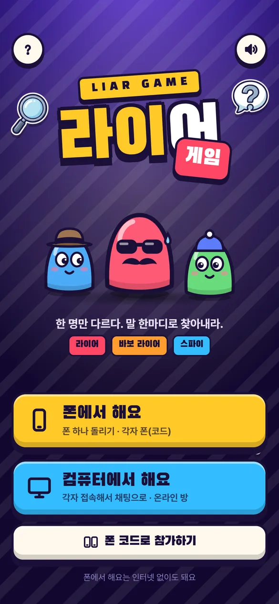
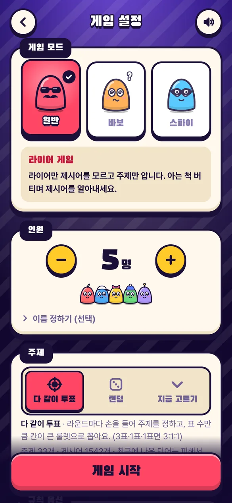
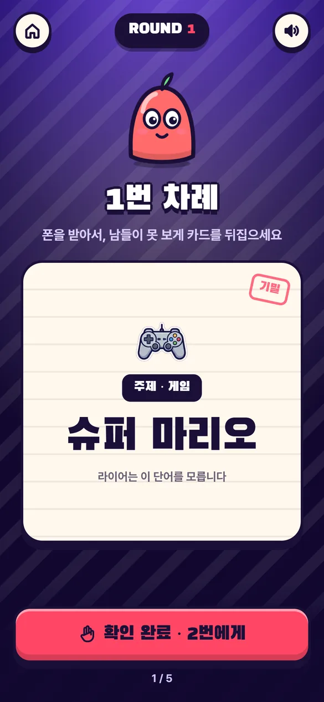
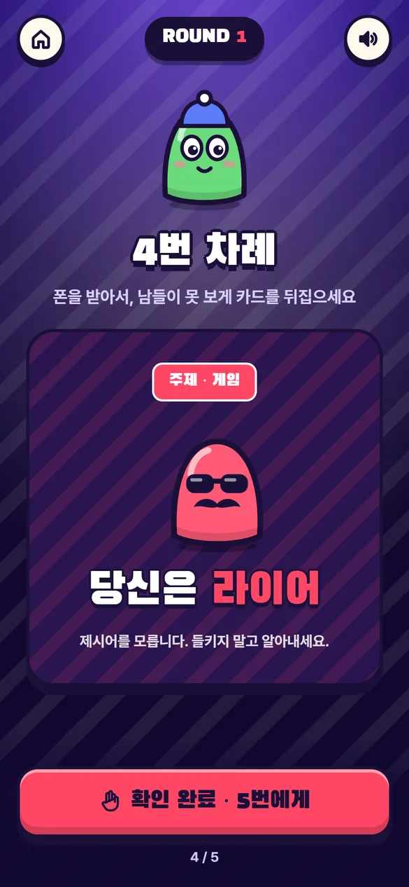
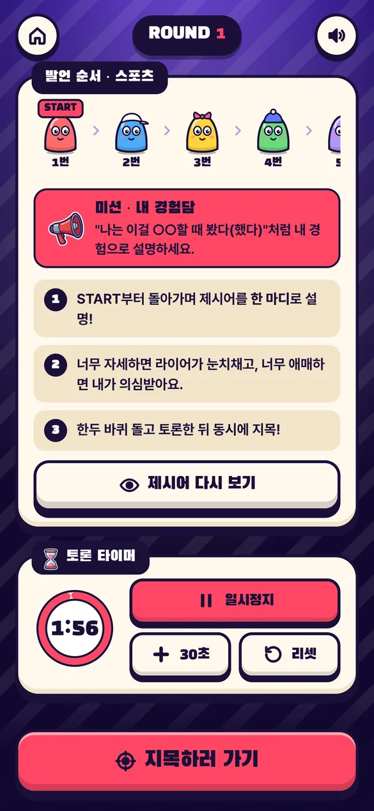
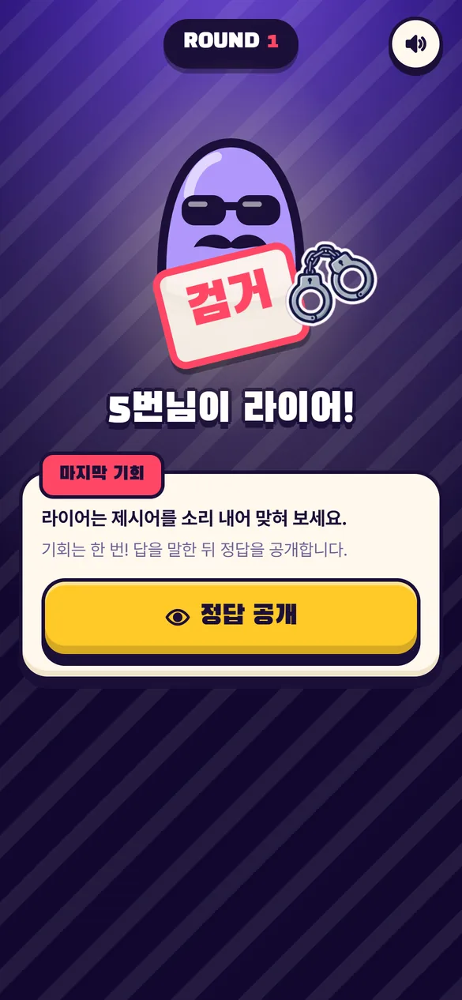
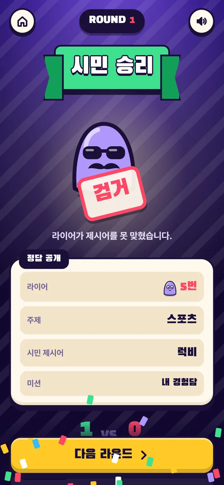

# 라이어 게임

**플레이: https://41ways.github.io/liar-game/**

한 명만 다르다. 말 한마디로 찾아내는 파티 게임. 서버 없이 HTML 파일 하나로 동작합니다.

- **라이어 게임**: 라이어만 제시어 대신 주제를 봅니다.
- **바보 라이어**: 라이어도 같은 주제의 다른 단어를 받고, 본인은 모릅니다.
- **스파이 게임**: 스파이만 다른 단어. 질문에 1~10 숫자로 동시에 답하고 튀는 사람을 찾습니다.

폰 한 대를 돌리거나, 코드 6자리를 나눠 각자 폰으로 할 수 있습니다. 주제 33개·제시어 약 1,500개, 라이어 수 1~3명, 공범, 힌트, 라운드 미션, 내 주제, 벌칙, 점수판.

<table>
<tr>
<td></td>
<td></td>
<td></td>
<td></td>
</tr>
<tr><td align="center">처음 화면</td><td align="center">게임 설정</td><td align="center">제시어 확인</td><td align="center">라이어에게는</td></tr>
<tr>
<td></td>
<td></td>
<td></td>
<td></td>
</tr>
<tr><td align="center">토론 · 미션 · 타이머</td><td align="center">지목 — 검거!</td><td align="center">정답 공개 · 점수</td><td></td></tr>
</table>

## 개발

`index.html` 은 빌드 결과물입니다. `src/app.html`, `src/data.js` 를 고친 뒤:

```bash
python tools/build.py
```

자세한 내용은 [docs/HANDOFF.md](docs/HANDOFF.md).

글꼴: Black Han Sans, Pretendard (SIL Open Font License).
